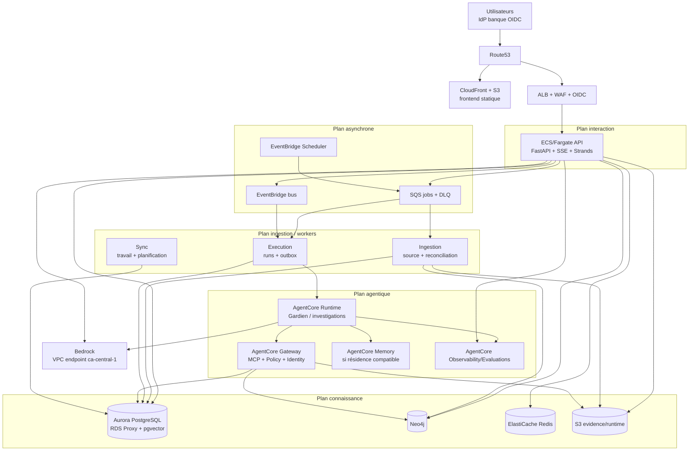
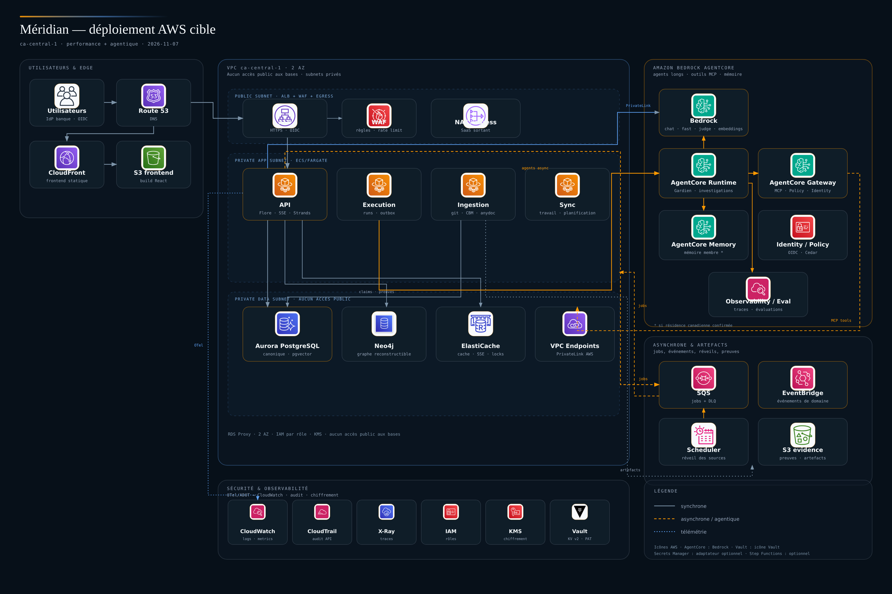
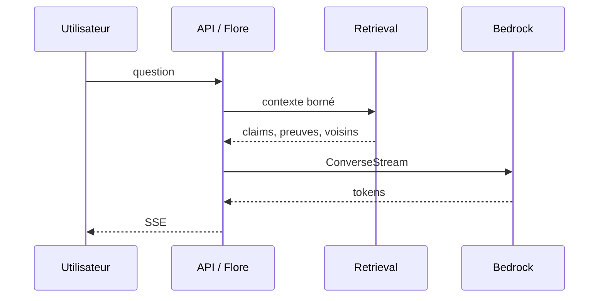
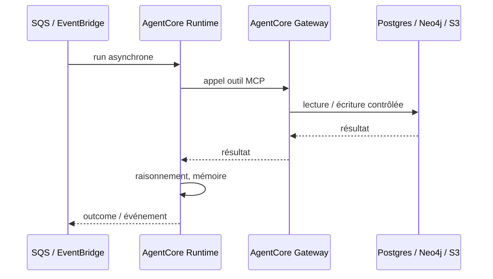

# Méridian — architecture cible AWS

## Performance, agentique et exploitation

> **Statut :** cible de référence proposée, à valider par l’architecture et la sécurité.
> **Date :** 7 novembre 2026.
> **Périmètre :** infrastructure AWS, runtime, données, agents, performance, migration.
> **Arbitre :** ce document tranche les propositions dispersées entre
> [`aws-bedrock-target.md`](aws-bedrock-target.md),
> [`MERIDIAN_Jumeau_Architecture_AWS_v1.md`](../MERIDIAN_Jumeau_Architecture_AWS_v1.md) et
> [`MERIDIAN_Technical_Architecture_v1.md`](../MERIDIAN_Technical_Architecture_v1.md).
> En cas de divergence, cette cible AWS prévaut pour l’infrastructure et la performance.

---

## 0. Résumé exécutif

La meilleure architecture pour Méridian n’est pas « tout AgentCore » ni « tout ECS ».
C’est un **hybride à deux chemins** :

1. **chemin interactif court** — Flore répond depuis l’API, avec Strands, Bedrock en
   streaming, retrieval borné et outils locaux en processus. Pas de Step Functions,
   pas de Gateway, pas d’écriture mémoire synchrone sur ce chemin.
2. **chemin agentique long** — Gardien, investigations, experts et ingestion passent
   par SQS/EventBridge, AgentCore Runtime, AgentCore Gateway, AgentCore Memory et
   AgentCore Identity/Policy, de façon asynchrone et gouvernée.

Les données restent dans **Aurora PostgreSQL** (canonique, RLS, pgvector), **Neo4j**
(graphe reconstructible), **S3** (preuves et artefacts) et **ElastiCache Redis**
(cache, SSE, verrous). Aucun agent ni mémoire managée ne devient source de vérité.

Décisions structurantes :

- **ECS/Fargate**, pas EKS, sauf obligation de la banque ;
- **une image, plusieurs rôles de processus** : API, ingestion, execution, sync ;
- **Aurora PostgreSQL + RDS Proxy**, pas DocumentDB ;
- **Neo4j** maintenant, Neptune seulement si obligation ;
- **SQS pour les jobs**, **EventBridge pour les événements de domaine**, jamais les deux
  pour le même message ;
- **Postgres reste la vérité d’exécution** ; Step Functions seulement pour les workflows
  longs avec approbation ;
- **AgentCore pour l’asynchrone et la gouvernance**, pas pour chaque tour de Flore ;
- **Floci pour le développement/CI**, **un compte AWS de staging** pour valider VPC,
  IAM, RDS et Bedrock.

---

## 1. Objectifs et non-objectifs

### Objectifs

- Réduire la latence perçue de Flore : premier token, réponse complète, streaming.
- Tenir la charge d’ingestion et d’indexation sans bloquer l’interaction.
- Isoler les workloads agentiques longs des requêtes utilisateurs.
- Utiliser les services AWS agentic là où ils apportent gouvernance, isolation et
  observabilité, sans payer un hop réseau sur le chemin chaud.
- Garder une seule chaîne de traçabilité : source → claim → preuve → décision → outcome.
- Pouvoir démarrer petit (un tenant, un pilote) et scaler sans réécrire.

### Non-objectifs

- Microservices par worker dès le premier jour.
- Step Functions comme seconde source de vérité des runs.
- AgentCore Memory comme stockage de la connaissance d’entreprise.
- DocumentDB comme nouvelle maison du legacy Mongo.
- Neptune tant que le code est Neo4j.
- CloudFront pour des utilisateurs strictement internes.
- Lambda pour les runs agents longs.

---

## 2. Hypothèses de dimensionnement

Ces chiffres sont des **hypothèses de travail**, pas des engagements. Ils servent à
dimensionner et à tester ; ils doivent être remplacés par les mesures du pilote.

| Dimension | Pilote | Production | Scale |
|---|---:|---:|---:|
| Tenants | 1 | 1–5 | 10+ |
| Utilisateurs | 50 | 500 | 5 000 |
| Sessions Flore simultanées | 20 | 100 | 1 000 |
| Twins | 10 000 | 100 000 | 1 000 000 |
| Claims + relations | 1 M | 10 M | 100 M |
| Dépôts ingérés | 200 | 2 000 | 20 000 |
| Artefacts S3 | 1 To | 10 To | 100 To |
| Ingestion / jour | 10–50 runs | 200–1 000 runs | 5 000+ runs |
| Rétention preuves | 1 an | 5 ans | selon politique |

Dimensionnement de départ :

| Composant | Pilote | Notes |
|---|---|---|
| API Fargate | 2 tâches, 2 vCPU / 4 Go | autoscale 2–10 ; cible CPU 60 % et p95 latence |
| Ingestion Fargate | 2 tâches, 4 vCPU / 8 Go, 100 Go éphémère | Batch ou tâche dédiée pour les gros dépôts |
| Execution worker | 2 tâches, 2 vCPU / 4 Go | autoscale 2–20 sur profondeur SQS |
| Sync worker | 1 tâche, 1 vCPU / 2 Go | read models, planification |
| Aurora PostgreSQL | writer 4 vCPU / 16 Go, reader 2 vCPU / 8 Go | RDS Proxy obligatoire ; Serverless v2 possible |
| Neo4j | 2 vCPU / 8 Go, 100 Go EBS | Aura si résidence compatible, sinon auto-hébergé |
| ElastiCache Redis | 2 Go, Multi-AZ | cache, SSE, verrous, rate limit |
| S3 | 1 To, versioning + lifecycle | deux buckets : evidence et runtime |
| Bedrock | quotas par tenant | modèles chat/fast/judge/embedding |

> Vérifier l’architecture du binaire CBM : s’il est x86-only, les tâches d’ingestion
> restent x86 ; l’API peut passer sur Graviton si les wheels Python suivent.

---

## 3. SLO de départ

Ces SLO sont des **cibles de conception**. Bedrock peut dominer la latence ; on mesure
séparément le temps applicatif et le temps modèle.

| Indicateur | Pilote | Production | Mesure |
|---|---:|---:|---|
| Disponibilité API | 99,5 % | 99,9 % | ALB/CloudWatch |
| API hors LLM, p95 | ≤ 300 ms | ≤ 250 ms | OTel |
| Retrieval, p95 | ≤ 500 ms | ≤ 400 ms | OTel |
| Premier token Flore, p95 | ≤ 3,5 s | ≤ 2,5 s | SSE |
| Réponse simple, p95 | ≤ 10 s | ≤ 8 s | SSE |
| Réponse avec outils, p95 | ≤ 30 s | ≤ 20 s | SSE |
| Erreurs SSE | ≤ 1 % | ≤ 0,5 % | logs/OTel |
| Fraîcheur après webhook, p95 | ≤ 10 min | ≤ 5 min | ingestion_run |
| Fraîcheur planifiée | ≤ 24 h | ≤ 12 h | Scheduler |
| Lag file interactive, p95 | ≤ 60 s | ≤ 30 s | SQS |
| Lag file batch, p95 | ≤ 15 min | ≤ 10 min | SQS |
| Succès des runs agentiques | ≥ 98 % | ≥ 99 % | exécution |
| Coût / tour interactif | à mesurer | budget par tenant | tokens + infra |
| Coût / run d’ingestion | à mesurer | budget par dépôt | tokens + CPU |

Les SLO seront revus après deux semaines de mesures réelles. Un SLO non mesuré est une
intention, pas une garantie.

---

## 4. Vue d’ensemble



Vue en couches :

```text
Edge        : Route53, CloudFront (si externe), ALB, WAF, OIDC
Interaction : API FastAPI/SSE, Strands, Bedrock streaming
Agentique   : AgentCore Runtime, Gateway, Memory, Identity, Policy, Evaluations
Workers     : ingestion, execution, sync
Données     : Aurora PostgreSQL, Neo4j, Redis, S3
Asynchrone  : SQS, EventBridge, Scheduler
Observabilité: OTel/ADOT, CloudWatch, AgentCore Observability
```

### Diagramme de déploiement AWS



[Ouvrir le diagramme en grand (HTML)](../diagrammes/deploiement-aws.html) ·
[SVG](../diagrammes/deploiement-aws.svg)

Le diagramme utilise les icônes AWS officielles. AgentCore est représenté avec
l’icône Bedrock, faute d’icône AgentCore dédiée dans le jeu local. Vault utilise son
icône propre (non AWS) ; Secrets Manager est un adaptateur optionnel, pas le coffre
principal.

---

## 5. Décisions structurantes

| ID | Décision | Pourquoi | Alternative rejetée |
|---|---|---|---|
| D1 | ECS/Fargate | simplicité, coût, pas de besoin Kubernetes | EKS sauf obligation |
| D2 | Une image, quatre rôles | monolithe modulaire, pas de microservices précoces | un service par worker |
| D3 | Aurora PostgreSQL + RDS Proxy | source canonique unique, RLS, pgvector, pooling | DocumentDB |
| D4 | Neo4j | le code est Cypher/Neo4j, projection reconstructible | Neptune au pilote |
| D5 | SQS jobs + EventBridge domaine | séparation travail/événement, DLQ, fan-out | un seul bus pour tout |
| D6 | Postgres vérité d’exécution | runs, bail, reprise, idempotence déjà implémentés | Step Functions comme vérité |
| D7 | AgentCore pour l’asynchrone | isolation, sessions, gateway, policy | AgentCore sur chaque tour |
| D8 | Gateway pour outils externes | MCP, Cedar, Identity, audit | Gateway pour la DB locale |
| D9 | Un tenant par environnement au pilote | isolation simple et forte | RLS partagée dès le pilote |
| D10 | ALB + WAF interne | utilisateurs banque, pas de CDN mondial nécessaire | CloudFront systématique |
| D11 | Floci dev/CI seulement | valide la plomberie, pas Bedrock/VPC/IAM réels | Floci comme staging |
| D12 | AgentCore Memory seulement si résidence OK | mémoire de membre, pas connaissance canonique | Memory comme source de vérité |
| D13 | Vault comme coffre principal | déjà utilisé pour les PAT, rotation, audit, auth IAM/Agent | Secrets Manager comme source principale |

---

## 6. Choix de services

| Domaine | Choix | Pourquoi | À éviter |
|---|---|---|---|
| Calcul API | ECS/Fargate | contrôle, longue durée, streaming, DB | Lambda pour Flore |
| Calcul ingestion | ECS/Fargate, Batch si gros dépôts | CPU/RAM/disque, CBM | Lambda |
| Agents longs | AgentCore Runtime | sessions, isolation, gouvernance | AgentCore pour chaque tour |
| Outils | AgentCore Gateway + MCP | Policy, Identity, audit | Gateway sur le chemin chaud local |
| Mémoire | Redis + S3 + Postgres ; AgentCore Memory optionnel | latence et résidence | Memory comme canonique |
| Modèles | Bedrock | résidence, IAM, PrivateLink | DeepSeek/OpenAI en profil bancaire |
| Base canonique | Aurora PostgreSQL | RLS, pgvector, read replicas | DocumentDB, Mongo canonique |
| Graphe | Neo4j | code existant, Cypher | Neptune sans adapter |
| Cache | ElastiCache Redis | SSE, locks, retrieval chaud | Redis comme vérité |
| Objets | S3 evidence + runtime | durabilité, Object Lock, lifecycle | disque local |
| Secrets | HashiCorp Vault KV v2 | coffre déjà utilisé, rotation, audit, auth IAM/Agent | Secrets Manager comme source principale |
| Jobs | SQS + DLQ | simplicité, priorité, backoff | Kafka/MSK au pilote |
| Événements | EventBridge | domaine, fan-out, scheduler | SQS pour tout |
| Orchestration longue | Step Functions (optionnel) | approbations, fan-out | Step Functions par tour |
| RAG documentaire | pgvector/Neo4j | ACL, provenance, coût | Knowledge Bases comme canonique |
| Garde-fous | Bedrock Guardrails ciblés | sécurité sans latence systématique | Guardrails sur chaque token |
| Observabilité | OTel/ADOT + CloudWatch + AgentCore Observability | traces, coûts, SLO | logs seuls |
| Edge | ALB + WAF + OIDC | interne, simple | CloudFront interne |
| IaC | Terraform | Floci et AWS réel | clic console |

---

## 7. Chemin chaud et chemin froid

### 7.1 Chemin chaud — Flore interactive



Règles :

- pas de Step Functions ;
- pas de Gateway pour les lectures locales ;
- pas d’écriture mémoire synchrone ;
- retrieval borné (top-k, profondeur graphe ≤ 2) ;
- streaming dès le premier token ;
- cache Redis/in-process pour les objets chauds ;
- Guardrails seulement sur les sorties sensibles.

### 7.2 Chemin froid — agents longs et ingestion



Règles :

- SQS pour les jobs, EventBridge pour les événements ;
- AgentCore Runtime pour les runs longs ;
- Gateway pour les outils externes et MCP ;
- Memory pour la mémoire de membre, pas la connaissance ;
- DLQ, backoff, idempotence ;
- évaluations et traces AgentCore en asynchrone.

---

## 8. Architecture de données

| Donnée | Store | Rôle | Performance |
|---|---|---|---|
| Twins, claims, preuves, décisions, mémoire durable | Aurora PostgreSQL | canonique | writer + reader, RDS Proxy, index |
| Embeddings, chunks | Aurora PostgreSQL + pgvector HNSW | retrieval | index ANN, read replica |
| Graphe, relations, communautés | Neo4j | projection | index propriétés, profondeur bornée |
| Sessions, SSE, cache, verrous | ElastiCache Redis | éphémère | sous-10 ms |
| Preuves, index, artefacts | S3 evidence | immuable | Object Lock, KMS, lifecycle |
| Sessions Flore, fichiers temporaires | S3 runtime | éphémère | lifecycle court |
| Events | EventBridge | domaine | fan-out |
| Jobs | SQS | travail | priorité, DLQ |
| Secrets d’accès | HashiCorp Vault KV v2 | coffre principal | auth IAM/Agent, audit, rotation |

Règles :

- **un seul canonique** : Postgres ;
- **le graphe est reconstructible** depuis Postgres/Mongo legacy ;
- **Redis n’est jamais la vérité** ;
- **S3 evidence** a une rétention longue et Object Lock ;
- **S3 runtime** a une rétention courte et un lifecycle ;
- **Vault** porte les secrets ; Postgres ne stocke que des références `vault:…` ;
- **pas de DocumentDB** si Work migre vers Postgres.

### Tenancy

- Pilote : **un tenant par environnement**.
- SaaS : base partagée + RLS, rôles DB distincts :
  - `meridian_app` : RLS activée ;
  - `meridian_worker` : BYPASSRLS ou liste de tenants ;
  - `meridian_migrator` : DDL uniquement.
- Aucun worker multi-tenant sans rôle dédié et tests d’isolation.

---

## 9. Performance engineering

### 9.1 API et interaction

Budget indicatif d’un tour interactif (p95, hors modèle très lent) :

| Étape | Budget |
|---|---:|
| Auth / RBAC / tenant | ≤ 30 ms |
| Résolution de contexte + retrieval | ≤ 400 ms |
| Premier token Bedrock | ≤ 2,0 s |
| 1–2 outils locaux | ≤ 1,0 s |
| Génération restante | ≤ 5,0 s |
| Persistance mémoire | hors chemin critique |

Ce budget n’est pas une somme stricte : le streaming recouvre la génération et le
premier token. Il sert à localiser la régression quand la p95 se dégrade.

- FastAPI async, SSE, ALB (pas API Gateway pour les longs streams).
- Client Bedrock réutilisé, keep-alive, pool de connexions.
- `aioboto3` ou threads bornés pour ne pas bloquer l’event loop.
- RDS Proxy devant Postgres : le code ouvre des connexions par requête.
- Redis pour le cache de contexte, les sessions, les verrous et le fan-out SSE.
- Cache LRU in-process pour les Twins/Claims chauds, invalidé par événements.
- Prompt caching Bedrock si disponible ; contexte hiérarchisé ; top-k borné.
- ALB idle timeout ≥ 300 s ; heartbeat SSE régulier.

### 9.2 Retrieval

- pgvector HNSW, pas de scan Python à l’échelle.
- Neo4j indexé ; profondeur de voisinage bornée.
- Résumés hiérarchiques et communautés précalculés.
- Read replica Aurora pour la recherche et l’analytique ; les lectures critiques
  (décision, preuve) restent sur le writer ou avec cohérence de session.
- Cache Redis des résultats fréquents.
- Mesurer recall/précision, pas seulement la latence.

### 9.3 Ingestion

- File SQS priorisée ; autoscaling sur profondeur.
- SQS standard par défaut ; FIFO par tenant seulement si l’ordre est requis.
- Image d’ingestion séparée si CBM/anydoc/git/Java alourdissent l’image API.
- Fargate avec stockage éphémère suffisant ; Batch pour les gros dépôts.
- CBM indexé une fois, artefact S3 réutilisé ; pas de réindexation globale.
- Parallélisme par dépôt, pas par fichier.
- Webhook comme accélérateur, jamais comme vérité.

### 9.4 Modèles

- Routage par rôle : `fast` pour router/classifier, `chat` pour répondre,
  `judge` pour évaluer, `embedding` pour Titan.
- Streaming systématique pour l’interactif.
- Fallback modèle dans la même région ; circuit breaker ; retries avec jitter.
- Quotas Bedrock par tenant ; budget tokens ; alarmes.
- Guardrails ciblés, pas sur chaque appel interne.

### 9.5 Autoscaling

| Service | Métrique | Min–max |
|---|---|---|
| API | CPU + p95 latence + requêtes | 2–10 |
| Ingestion | profondeur SQS + mémoire | 2–20 |
| Runtime | profondeur SQS | 2–20 |
| Sync | CPU / retard | 1–4 |

- Files séparées : interactive, standard, batch.
- Le batch ne doit jamais affamer l’interactif.
- Budgets de tokens et de runs par tenant.

### 9.6 Tests de performance

- Charge API/SSE : 20, 100, 1 000 sessions simultanées.
- Retrieval : recall/précision + p95 sur un corpus labellisé.
- Ingestion : 1 000 dépôts, gros dépôts, reprise après crash.
- Bedrock : latence et coût par modèle, throttling, fallback.
- Chaos léger : Redis indisponible, Neo4j lent, RDS failover, DLQ.
- Test de charge 10× avant production.
- Les résultats alimentent les SLO, pas l’inverse.

---

## 10. Agentique AWS

### 10.1 Strands + Bedrock

- Le code Strands actuel reste le framework des agents.
- Bedrock est le fournisseur de modèles en `ca-central-1`.
- AgentCore Runtime encapsule le même code (`BedrockAgentCoreApp`) pour les runs longs.

### 10.2 AgentCore Runtime

Utilisé pour :

- Gardien (fiche vivante après commit) ;
- investigations longues ;
- experts spécialisés ;
- runs batch.

Pas utilisé pour :

- chaque tour de Flore ;
- lecture locale Postgres ;
- opérations déterministes courtes.

### 10.3 AgentCore Gateway

Utilisé pour :

- outils MCP externes (CBM, Confluence, ServiceNow, APIs) ;
- Policy Cedar ;
- Identity ;
- audit centralisé.

Pas utilisé pour :

- les lectures locales Postgres/Neo4j du chemin chaud ;
- chaque outil interne.

### 10.4 AgentCore Memory

- Mémoire de membre, résumés, préférences.
- Écriture asynchrone, jamais sur le chemin critique.
- **À vérifier : résidence canadienne de Memory.** Si non conforme, garder la mémoire
  dans S3/Postgres/Redis en `ca-central-1` et utiliser AgentCore Runtime/Gateway seuls.

### 10.5 AgentCore Identity / Policy / Observability / Evaluations

- Identity : action au nom de l’utilisateur, OAuth/OIDC.
- Policy : Cedar, outils autorisés, lecture/écriture.
- Observability : traces agents, outils, modèles.
- Evaluations : hors ligne, avant changement de prompt/modèle.

### 10.6 Bedrock Agents, Knowledge Bases, Guardrails

- **Bedrock Agents** n’est pas retenu pour le cœur : moins de contrôle sur la boucle,
  les preuves, les citations et les outils maison.
- **Knowledge Bases** reste optionnel pour le RAG documentaire ; la connaissance
  canonique et les ACL restent dans Postgres/Neo4j.
- **Guardrails** ciblés sur les sorties sensibles ou externes, pas sur chaque token.

---

## 11. Sécurité, réseau et conformité

- VPC sur 2 AZ : sous-réseaux publics ALB, privés API/workers/données.
- Aucun accès public aux bases, à Redis, à Neo4j ou à Bedrock.
- VPC endpoints : S3, SQS, KMS, CloudWatch, Bedrock, AgentCore ; Vault via endpoint
  privé, VPN ou peering selon son hébergement.
- NAT Gateway ou proxy d’egress journalisé pour GitHub/Confluence/ServiceNow/Datadog.
- ALB + WAF + OIDC ; CloudFront seulement si accès externe.
- IAM par rôle : `api`, `worker`, `ingestion`, `scheduler` ; pas un rôle unique.
- **Vault** comme coffre principal : KV v2, auth AWS IAM ou Vault Agent, audit, rotation ;
  Secrets Manager uniquement comme adaptateur optionnel pour des secrets AWS natifs.
  Aucune clé dans Git, dans un prompt ou dans un fichier de configuration.
- RLS activée pour le multi-tenant ; rôles DB distincts.
- CloudTrail, VPC Flow Logs, S3 access logs, RDS audit logs.
- Guardrails et politiques de sortie pour les données sensibles.
- Résidence `ca-central-1` pour les données ; vérifier chaque service AgentCore.

### Continuité (cibles à valider)

| Donnée | RPO | RTO | Mécanisme |
|---|---:|---:|---|
| Aurora PostgreSQL | ≤ 5 min | ≤ 2 h | PITR, Multi-AZ |
| S3 evidence | ~0 | ≤ 1 h | versioning, Object Lock, réplication |
| Neo4j | reconstructible | ≤ 4 h | snapshot + rebuild depuis Postgres |
| Redis | perte acceptable | ≤ 15 min | reconstruction cache/SSE |
| Files SQS | non critique | ≤ 1 h | DLQ, replay |

---

## 12. Observabilité et SLO

- OpenTelemetry/ADOT pour API, workers, outils, Bedrock.
- CloudWatch Logs structurés : `tenant_id`, `run_id`, `session_id`, `tool`, `model`.
- Métriques : latence API, premier token, durée modèle, tokens, coût, retrieval,
  queue lag, ingestion lag, taux d’erreur, cache hit.
- Traces : API → retrieval → Bedrock → outil → réponse.
- AgentCore Observability pour les runs agentiques.
- Tableaux de bord par SLO ; alarmes sur :
  - p95 premier token ;
  - erreurs SSE ;
  - lag SQS ;
  - DLQ > 0 ;
  - échec d’ingestion ;
  - quota Bedrock ;
  - coût anormal.
- Évaluations AgentCore hors ligne avant tout changement de prompt/modèle.

---

## 13. Coûts et garde-fous

Postes principaux :

- Fargate API/workers ;
- Aurora PostgreSQL + RDS Proxy + read replicas ;
- Neo4j (Aura ou auto-hébergé) ;
- ElastiCache Redis ;
- NAT Gateway / egress proxy ;
- S3 + lifecycle ;
- Bedrock (tokens, éventuellement provisioned throughput) ;
- AgentCore Runtime/Gateway/Memory ;
- CloudWatch/OTel.

Leviers :

- autoscaling sur la charge réelle ;
- lifecycle S3 ;
- cache Redis/in-process ;
- modèles `fast` pour router ;
- prompt caching ;
- batch ingestion hors heures ;
- arrêt des environnements hors production ;
- budget par tenant et alarmes.

Un budget mensuel cible doit être fixé avant le pilote. Sans budget, l’architecture
sera techniquement correcte mais économiquement non validée.

---

## 14. Plan de migration en 3 étapes

### Étape 1 — Socle AWS performant (4–6 semaines)

**Objectif :** API et workers sur AWS staging, données canoniques Postgres, pas
d’AgentCore sur le chemin chaud.

Livrables :

- Dockerfile + entrypoint `api`, `ingestion`, `execution`, `sync` ;
- Terraform AWS : réseau, données, application, observabilité ;
- Aurora PostgreSQL + RDS Proxy + rôles DB + migrations versionnées ;
- S3 evidence/runtime, ElastiCache Redis, SQS + DLQ, EventBridge, Scheduler ;
- Vault KV v2, auth IAM ou Vault Agent, chemins `vault:…` ; Secrets Manager
  seulement comme adaptateur optionnel ;
- migration Work Mongo → Postgres ;
- OTel/CloudWatch, dashboards et alarmes ;
- CI/CD GitHub Actions → ECR → ECS ;
- smoke Floci en CI, smoke AWS staging avec Bedrock réel ;
- tests de charge API/SSE, retrieval, ingestion.

Critères de sortie :

- API et workers démarrent sur AWS staging ;
- Vault est joignable depuis le VPC, les PAT sont lus par `vault:…`, rotation et audit vérifiés ;
- Work lit/écrit Postgres ;
- Bedrock chat + embeddings fonctionnent en `ca-central-1` ;
- SLO interactifs mesurés ;
- aucun DocumentDB/Neptune/AgentCore sur le chemin chaud ;
- RLS et rôles DB testés.

### Étape 2 — Agentique gouverné (4–6 semaines)

**Objectif :** les agents longs passent sur AgentCore, sans dégrader Flore.

Livrables :

- AgentCore Runtime : Gardien, investigations, experts ;
- AgentCore Gateway : CBM, Confluence, Claims, documents en MCP ;
- AgentCore Identity/Policy : Cedar, acteur, outils autorisés ;
- AgentCore Memory si résidence confirmée ;
- AgentCore Observability/Evaluations ;
- Step Functions pour les approbations longues, en lecture de l’état Postgres ;
- Bedrock Guardrails ciblés ;
- tests de non-régression des SLO interactifs.

Critères de sortie :

- un run Gardien et une investigation longue tournent sur AgentCore ;
- les outils externes passent par Gateway ;
- les évaluations sont reproductibles ;
- les SLO Flore ne régressent pas ;
- la mémoire respecte la résidence ou reste dans S3/Postgres/Redis.

### Étape 3 — Scale et résilience (6–10 semaines)

**Objectif :** passer du pilote à la production multi-tenant et multi-AZ.

Livrables :

- read replicas Aurora, autoscaling, Multi-AZ ;
- RLS multi-tenant, tests d’isolation, quotas par tenant ;
- PITR, backups Neo4j, Object Lock, plan de restauration ;
- DR, RTO/RPO validés ;
- tests de charge 10×, chaos léger, runbooks ;
- optimisation coûts (Graviton si possible, lifecycle, batch) ;
- Neptune seulement si obligation, avec adapter dédié.

Critères de sortie :

- SLO production tenus sous charge ;
- coût par tenant mesuré ;
- RTO/RPO validés ;
- isolation tenant prouvée ;
- runbooks d’incident et de DLQ ;
- décision finale sur Neptune/DocumentDB/AgentCore Memory.

---

## 15. Risques et questions ouvertes

| Risque | Impact | Mitigation |
|---|---|---|
| AgentCore indisponible ou hors Canada | conformité | Strands sur ECS ; Memory dans S3/Postgres |
| Bedrock quotas/accès | latence/qualité | staging réel, fallback modèle, quotas |
| CBM binaire x86/lourd | image et coût | image ingestion dédiée, x86 |
| Migration Work Mongo | régression | double lecture, tests, cutover |
| RLS multi-tenant | fuite | un tenant par env au pilote, tests |
| Connexions Postgres | saturation | RDS Proxy, pool |
| Step Functions comme vérité | divergence | Postgres reste la vérité |
| Gateway sur chemin chaud | latence | outils locaux en processus |
| Vault indisponible ou latence | secrets bloqués | Vault HA, Vault Agent, cache court, Secrets Manager adaptateur |
| Coût Bedrock/AgentCore | budget | quotas, budgets, modèles fast |

Questions à trancher :

1. AgentCore Runtime/Gateway/Memory sont-ils disponibles en `ca-central-1` avec une
   résidence acceptable ?
2. La priorité est-elle la latence interactive ou le débit batch ?
3. EKS, Neptune, DocumentDB ou Step Functions sont-ils imposés par la banque ?
4. Quel est le budget mensuel cible ?
5. Quels RTO/RPO et quelle rétention de preuves ?
6. Peut-on migrer Work vers Postgres avant AWS, ou DocumentDB est-il imposé ?
7. Vault est-il hébergé dans le VPC, on-premise ou en HCP Vault, et quelle méthode
   d’authentification (IAM, Agent, AppRole) est autorisée par la banque ?

---

## 16. Références

- [Cible Bedrock](aws-bedrock-target.md)
- [Laboratoire AWS local Floci](floci-aws-local.md)
- [Écarts avec la vision](ecarts-vision.md)
- [État actuel](etat-actuel.md)
- [Architecture maître](../MERIDIAN_Architecture_Master_v1.md)
- [Architecture technique](../MERIDIAN_Technical_Architecture_v1.md)
- [Architecture AWS du jumeau agentique](../MERIDIAN_Jumeau_Architecture_AWS_v1.md)
- [ADR-0010 — monolithe modulaire](../adr/0010-monolithe-modulaire-hexagonal.md)
- [ADR-0013 — projection graphe](../adr/0013-projection-graphe.md)
- [ADR-0014 — adapters AWS sans lock-in](../adr/0014-adapters-aws-sans-lock-in.md)
